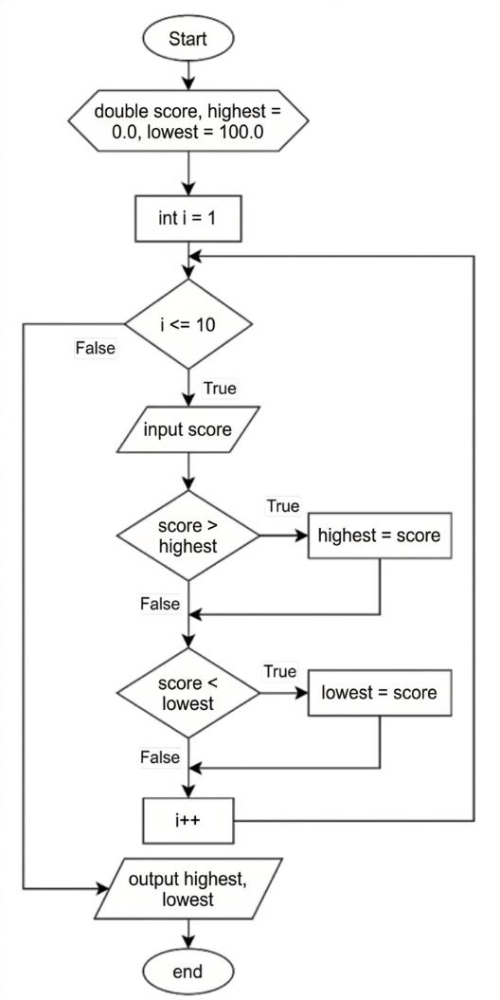
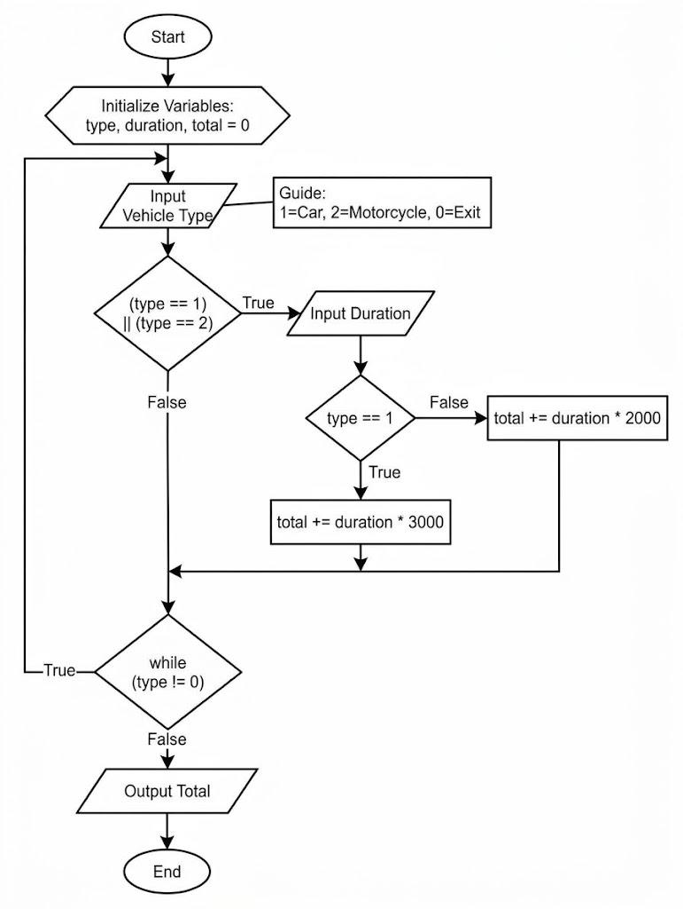

# Jobsheet 7: Loops 1 (Perulangan 1)

**Mata Kuliah:** Dasar Pemrograman (Programming Fundamentals) 2026
**Program Studi:** D4 Teknik Informatika, Politeknik Negeri Malang
**Repository:** `programming-fundamentals-jobsheet7`

> **Catatan:** Nama file dan nama class memakai `AttendanceNo`. Ganti dengan nomor absenmu, misalnya `SiakadForAttendanceNo` menjadi `SiakadFor05`. Nama file dan nama class di dalam kode harus sama.

---

## 1. Objectives (Tujuan)

- Mahasiswa menjelaskan sintaks program perulangan (`for`, `while`, dan `do-while`).
- Mahasiswa mengimplementasikan flowchart perulangan dengan bahasa Java.

## Struktur Folder

```
jobsheet7/
├── README.md
├── images/
│   ├── flowchart-eksperimen1.jpg
│   └── flowchart-tugas2.jpg
└── src/
    ├── SiakadForAttendanceNo.java
    ├── SiakadForModifikasiAttendanceNo.java
    ├── SiakadWhileAttendanceNo.java
    ├── SiakadWhileModifikasiAttendanceNo.java
    ├── CafeDoWhileAttendanceNo.java
    ├── TugasBioskopAttendanceNo.java
    └── TugasParkirAttendanceNo.java
```

## Cara Menjalankan

Buka terminal di folder `src`, lalu ketik:

```bash
javac SiakadForAttendanceNo.java
java SiakadForAttendanceNo
```

---

## 2.1 Eksperimen 1: Nilai Mahasiswa di SIAKAD (FOR Loop)

**Durasi:** 90 menit

Dosen memasukkan nilai kuis dari 10 mahasiswa dalam satu kelas. Program mencari dan menampilkan nilai tertinggi dan terendah.

### Flowchart



### Kode Program: `SiakadForAttendanceNo.java`

```java
import java.util.Scanner;

public class SiakadForAttendanceNo {
    public static void main(String[] args) {
        Scanner sc = new Scanner(System.in);

        double score, highest = 0, lowest = 100;

        for (int i = 1; i <= 10; i++) {
            System.out.print("Enter score for student " + i + ": ");
            score = sc.nextDouble();
            if (score > highest) {
                highest = score;
            }
            if (score < lowest) {
                lowest = score;
            }
        }

        System.out.println("Highest score: " + highest);
        System.out.println("Lowest score: " + lowest);
    }
}
```

### Hasil Percobaan

```
Enter score for student 1: 76.5
Enter score for student 2: 82.3
Enter score for student 3: 62.1
Enter score for student 4: 88.4
Enter score for student 5: 65.9
Enter score for student 6: 67.9
Enter score for student 7: 90.1
Enter score for student 8: 55.3
Enter score for student 9: 73.7
Enter score for student 10: 78.6
Highest score: 90.1
Lowest score: 55.3
```

### Pertanyaan

**1. Sebutkan komponen FOR loop pada kode Eksperimen 1.**

```java
for (int i = 1; i <= 10; i++) {
    // isi perulangan
}
```

| Komponen | Kode | Fungsi |
|---|---|---|
| Inisialisasi | `int i = 1` | Nilai awal variabel penghitung |
| Kondisi | `i <= 10` | Perulangan jalan selama kondisi ini `true` |
| Update | `i++` | Menaikkan `i` sebanyak 1 setiap putaran selesai |
| Isi (body) | `{ ... }` | Perintah yang diulang |

**2. Mengapa `highest` diisi 0 dan `lowest` diisi 100? Apa yang terjadi kalau dibalik?**

- `highest = 0`: nilai pertama yang kamu masukkan lebih besar dari 0, jadi `highest` terisi dari nilai itu.
- `lowest = 100`: nilai pertama lebih kecil dari 100, jadi `lowest` terisi dari nilai itu.
- Kalau kamu balik (`highest = 100`, `lowest = 0`), tidak ada nilai di atas 100 atau di bawah 0. Kedua `if` tidak pernah `true`. Program menampilkan Highest 100 dan Lowest 0 untuk data apa pun.

**3. Jelaskan fungsi dan alur kode berikut.**

```java
if (score > highest) {
    highest = score;
}
if (score < lowest) {
    lowest = score;
}
```

`if` pertama: kalau nilai baru lebih besar dari `highest`, program mengganti `highest` dengan nilai itu. `if` kedua: kalau nilai baru lebih kecil dari `lowest`, program mengganti `lowest`. Kedua `if` terpisah, jadi program memeriksa setiap nilai dua kali. Setelah 10 putaran, `highest` menyimpan nilai terbesar dan `lowest` menyimpan nilai terkecil.

**4. Modifikasi program untuk menghitung mahasiswa yang lulus dan tidak lulus (batas lulus minimal 60).**

File: `SiakadForModifikasiAttendanceNo.java`

```java
import java.util.Scanner;

public class SiakadForModifikasiAttendanceNo {
    public static void main(String[] args) {
        Scanner sc = new Scanner(System.in);

        double score, highest = 0, lowest = 100;
        int passCount = 0, failCount = 0;

        for (int i = 1; i <= 10; i++) {
            System.out.print("Enter score for student " + i + ": ");
            score = sc.nextDouble();
            if (score > highest) {
                highest = score;
            }
            if (score < lowest) {
                lowest = score;
            }
            // batas lulus minimal 60
            if (score >= 60) {
                passCount++;
            } else {
                failCount++;
            }
        }

        System.out.println("Highest score: " + highest);
        System.out.println("Lowest score: " + lowest);
        System.out.println("Number of students who pass: " + passCount);
        System.out.println("Number of students who fail: " + failCount);
    }
}
```

Contoh hasil, dengan 10 nilai yang sama seperti di atas:

```
Highest score: 90.1
Lowest score: 55.3
Number of students who pass: 9
Number of students who fail: 1
```

---

## 2.2 Eksperimen 2: Nilai Mahasiswa di SIAKAD (WHILE Loop)

**Durasi:** 90 menit

Dosen memasukkan nilai beberapa mahasiswa untuk menentukan nilai huruf. Kalau nilai negatif atau lebih dari 100, program mengabaikannya dan meminta input ulang.

| Nilai | Huruf |
|---|---|
| 80 < score ≤ 100 | A |
| 73 < score ≤ 80 | B+ |
| 65 < score ≤ 73 | B |
| 60 < score ≤ 65 | C+ |
| 50 < score ≤ 60 | C |
| 39 < score ≤ 50 | D |
| score ≤ 39 | E |

### Kode Program: `SiakadWhileAttendanceNo.java`

```java
import java.util.Scanner;

public class SiakadWhileAttendanceNo {
    public static void main(String[] args) {
        Scanner sc = new Scanner(System.in);

        int score, studentCount, i = 0;

        System.out.print("Enter the number of students: ");
        studentCount = sc.nextInt();

        while (i < studentCount) {
            System.out.print("Enter score for student " + (i + 1) + ": ");
            score = sc.nextInt();

            if (score < 0 || score > 100) {
                System.out.println("Invalid score. Please enter a valid score!");
                continue;
            }

            if (score > 80 && score <= 100) {
                System.out.println("The grade of student " + (i + 1) + " is A");
            } else if (score > 73 && score <= 80) {
                System.out.println("The grade of student " + (i + 1) + " is B+");
            } else if (score > 65 && score <= 73) {
                System.out.println("The grade of student " + (i + 1) + " is B");
            } else if (score > 60 && score <= 65) {
                System.out.println("The grade of student " + (i + 1) + " is C+");
            } else if (score > 50 && score <= 60) {
                System.out.println("The grade of student " + (i + 1) + " is C");
            } else if (score > 39 && score <= 50) {
                System.out.println("The grade of student " + (i + 1) + " is D");
            } else {
                System.out.println("The grade of student " + (i + 1) + " is E");
            }
            i++;
        }
    }
}
```

### Hasil Percobaan

```
Enter the number of students: 5
Enter score for student 1: 85
The grade of student 1 is A
Enter score for student 2: 63
The grade of student 2 is C+
Enter score for student 3: 101
Invalid score. Please enter a valid score!
Enter score for student 3: 23
The grade of student 3 is E
Enter score for student 4: -15
Invalid score. Please enter a valid score!
Enter score for student 4: 70
The grade of student 4 is B
Enter score for student 5: 55
The grade of student 5 is C
```

### Pertanyaan

**1. Jelaskan arti dan tujuan sintaks berikut.**

```java
if (score < 0 || score > 100) {
    System.out.println("Invalid score. Please enter a valid score!");
    continue;
}
```

**a. `score < 0 || score > 100`**

`||` berarti OR. Kondisi bernilai `true` kalau nilai kurang dari 0 atau lebih dari 100, yaitu nilai di luar rentang 0 sampai 100. Program memakainya untuk mendeteksi nilai tidak valid.

**b. `continue`**

`continue` melompati sisa isi perulangan dan kembali ke kondisi `while`. Baris `i++` ikut terlewati, jadi `i` tidak naik dan program meminta nilai untuk mahasiswa yang sama.

**2. Mengapa `i++` ditulis di akhir WHILE? Apa yang terjadi kalau ditulis di awal?**

Di akhir, `i` naik setelah program selesai memproses satu nilai valid. Kalau kamu menaruhnya di awal, `i` naik sebelum program memeriksa nilai. Nilai tidak valid tetap menghabiskan satu putaran, jadi ada mahasiswa yang tidak mendapat nilai, dan nomor mahasiswa di layar (`i + 1`) meleset satu.

**3. Kalau jumlah mahasiswa 19, berapa kali WHILE berjalan?**

19 putaran untuk nilai valid, karena `i` bergerak dari 0 sampai 18. Setiap nilai tidak valid menambah satu putaran, jadi isi perulangan berjalan lebih dari 19 kali kalau ada input salah.

**4. Modifikasi program: kalau mahasiswa mendapat nilai A, tampilkan pesan "Well done, keep up the good work!"**

File: `SiakadWhileModifikasiAttendanceNo.java`

```java
import java.util.Scanner;

public class SiakadWhileModifikasiAttendanceNo {
    public static void main(String[] args) {
        Scanner sc = new Scanner(System.in);

        int score, studentCount, i = 0;

        System.out.print("Enter the number of students: ");
        studentCount = sc.nextInt();

        while (i < studentCount) {
            System.out.print("Enter score for student " + (i + 1) + ": ");
            score = sc.nextInt();

            if (score < 0 || score > 100) {
                System.out.println("Invalid score. Please enter a valid score!");
                continue;
            }

            if (score > 80 && score <= 100) {
                System.out.println("The grade of student " + (i + 1) + " is A");
                System.out.println("Well done, keep up the good work!");
            } else if (score > 73 && score <= 80) {
                System.out.println("The grade of student " + (i + 1) + " is B+");
            } else if (score > 65 && score <= 73) {
                System.out.println("The grade of student " + (i + 1) + " is B");
            } else if (score > 60 && score <= 65) {
                System.out.println("The grade of student " + (i + 1) + " is C+");
            } else if (score > 50 && score <= 60) {
                System.out.println("The grade of student " + (i + 1) + " is C");
            } else if (score > 39 && score <= 50) {
                System.out.println("The grade of student " + (i + 1) + " is D");
            } else {
                System.out.println("The grade of student " + (i + 1) + " is E");
            }
            i++;
        }
    }
}
```

Contoh hasil:

```
Enter the number of students: 3
Enter score for student 1: 90
The grade of student 1 is A
Well done, keep up the good work!
Enter score for student 2: 70
The grade of student 2 is B
Enter score for student 3: 50
The grade of student 3 is D
```

---

## 2.3 Eksperimen 3: Transaksi Kafe (DO-WHILE Loop)

**Durasi:** 60 menit

Kasir kafe memproses transaksi beberapa pelanggan. Harga kopi Rp 12.000, teh Rp 7.000, dan roti Rp 20.000. Program berhenti kalau kasir mengetik "cancel" sebagai nama pelanggan.

### Kode Program: `CafeDoWhileAttendanceNo.java`

```java
import java.util.Scanner;

public class CafeDoWhileAttendanceNo {
    public static void main(String[] args) {
        Scanner sc = new Scanner(System.in);

        int coffee, tea, bread, totalPrice;
        String customerName;
        int coffeePrice = 12000, teaPrice = 7000, breadPrice = 20000;

        do {
            System.out.print("Enter customer name (type 'cancel' to exit): ");
            customerName = sc.nextLine();
            if (customerName.equalsIgnoreCase("cancel")) {
                System.out.println("Transaction canceled.");
                break;
            }
            System.out.print("Coffee quantity: ");
            coffee = sc.nextInt();
            System.out.print("Tea quantity: ");
            tea = sc.nextInt();
            System.out.print("Bread quantity: ");
            bread = sc.nextInt();
            totalPrice = (coffee * coffeePrice) + (tea * teaPrice) + (bread * breadPrice);
            System.out.println("Total amount to pay: Rp " + totalPrice);
            sc.nextLine(); // membersihkan karakter newline di buffer input
        } while (true);

        System.out.println("All transactions completed.");
    }
}
```

> **Catatan:** `sc.nextLine();` setelah `totalPrice` ditampilkan membersihkan karakter newline yang tersisa di buffer input.

### Hasil Percobaan

```
Enter customer name (type 'cancel' to exit): Rena
Coffee quantity: 3
Tea quantity: 0
Bread quantity: 1
Total amount to pay: Rp 56000
Enter customer name (type 'cancel' to exit): Yuni
Coffee quantity: 1
Tea quantity: 4
Bread quantity: 2
Total amount to pay: Rp 80000
Enter customer name (type 'cancel' to exit): CANCEL
Transaction canceled.
All transactions completed.
```

### Pertanyaan

**1. Kalau nama pelanggan pertama adalah "cancel", berapa kali perulangan berjalan?**

1 kali. DO-WHILE menjalankan isinya dulu. Program meminta nama, membaca "cancel", lalu menjalankan `break`.

**2. Sebutkan kondisi berhenti pada DO-WHILE ini.**

Perulangan berhenti saat nama yang dimasukkan "cancel". `equalsIgnoreCase` mengabaikan huruf besar dan kecil, jadi "CANCEL" juga berlaku. Perintah `break` yang menghentikan perulangan.

**3. Apa fungsi nilai `true` pada kondisi DO-WHILE?**

`true` membuat kondisi selalu terpenuhi. Perulangan jalan terus (infinite loop) sampai `break` dijalankan.

**4. Mengapa DO-WHILE ini jalan walaupun tidak ada inisialisasi dan update?**

Perulangan ini tidak menghitung putaran, jadi tidak perlu variabel seperti `i`. Kondisi `true` menjaga perulangan tetap jalan, dan `break` mengakhirinya.

---

## 3. Assignment (Tugas)

**Durasi:** 120 menit

### Tugas 1: Penjualan Tiket Bioskop

Harga tiket Rp 50.000. Program menghitung total tiket terjual dan total pendapatan satu hari dengan aturan:

- Beli lebih dari 4 tiket: diskon 10%.
- Beli lebih dari 10 tiket: diskon 15%.
- Jumlah tiket negatif tidak valid. Program mengabaikannya dan meminta input ulang.

Input `0` mengakhiri program.

File: `TugasBioskopAttendanceNo.java`

```java
import java.util.Scanner;

public class TugasBioskopAttendanceNo {
    public static void main(String[] args) {
        Scanner sc = new Scanner(System.in);

        final int TICKET_PRICE = 50000;
        int tickets, totalTickets = 0;
        double totalRevenue = 0;

        System.out.println("=== Cinema Ticket Sales ===");
        System.out.println("Enter the number of tickets for each customer (enter 0 to finish).");

        while (true) {
            System.out.print("Number of tickets: ");
            tickets = sc.nextInt();

            if (tickets < 0) {
                System.out.println("Invalid quantity. Please enter again!");
                continue;
            }
            if (tickets == 0) {
                break;
            }

            double price = tickets * TICKET_PRICE;
            double discount = 0;
            if (tickets > 10) {
                discount = 0.15;
            } else if (tickets > 4) {
                discount = 0.10;
            }
            double pay = price - (price * discount);

            System.out.printf("Discount: %.0f%%%n", discount * 100);
            System.out.printf("Total to pay: Rp %.0f%n", pay);

            totalTickets += tickets;
            totalRevenue += pay;
        }

        System.out.println("-------------------------");
        System.out.println("Total tickets sold: " + totalTickets);
        System.out.printf("Total revenue: Rp %.0f%n", totalRevenue);
    }
}
```

Contoh hasil:

```
=== Cinema Ticket Sales ===
Enter the number of tickets for each customer (enter 0 to finish).
Number of tickets: 3
Discount: 0%
Total to pay: Rp 150000
Number of tickets: -2
Invalid quantity. Please enter again!
Number of tickets: 5
Discount: 10%
Total to pay: Rp 225000
Number of tickets: 12
Discount: 15%
Total to pay: Rp 510000
Number of tickets: 0
-------------------------
Total tickets sold: 20
Total revenue: Rp 885000
```

### Tugas 2: Biaya Parkir (dari Flowchart)

Tarif parkir: mobil Rp 3.000 per jam, motor Rp 2.000 per jam. Program terus meminta input selama jenis kendaraan bukan 0.



File: `TugasParkirAttendanceNo.java`

```java
import java.util.Scanner;

public class TugasParkirAttendanceNo {
    public static void main(String[] args) {
        Scanner sc = new Scanner(System.in);

        int type = 0, duration = 0, total = 0;

        do {
            System.out.print("Enter vehicle type (1 = Car, 2 = Motorcycle, 0 = Exit): ");
            type = sc.nextInt();

            if (type == 1 || type == 2) {
                System.out.print("Enter duration (hours): ");
                duration = sc.nextInt();

                if (type == 1) {
                    total += duration * 3000;
                } else {
                    total += duration * 2000;
                }
            }
        } while (type != 0);

        System.out.println("Total parking fee: Rp " + total);
    }
}
```

Hubungan flowchart dan kode:

| Bagian flowchart | Kode Java |
|---|---|
| Initialize Variables: type, duration, total = 0 | `int type = 0, duration = 0, total = 0;` |
| Input Vehicle Type | `type = sc.nextInt();` |
| (type == 1) \|\| (type == 2) | `if (type == 1 \|\| type == 2)` |
| Input Duration | `duration = sc.nextInt();` |
| type == 1: total += duration * 3000, selain itu total += duration * 2000 | `if (type == 1) {...} else {...}` |
| while (type != 0) | `} while (type != 0);` |
| Output Total | `System.out.println("Total parking fee: Rp " + total);` |

Contoh hasil:

```
Enter vehicle type (1 = Car, 2 = Motorcycle, 0 = Exit): 1
Enter duration (hours): 3
Enter vehicle type (1 = Car, 2 = Motorcycle, 0 = Exit): 2
Enter duration (hours): 4
Enter vehicle type (1 = Car, 2 = Motorcycle, 0 = Exit): 7
Enter vehicle type (1 = Car, 2 = Motorcycle, 0 = Exit): 0
Total parking fee: Rp 17000
```

Mobil 3 jam = 9.000, motor 4 jam = 8.000, jenis `7` diabaikan. Total 17.000.

---

## Commit dan Push ke GitHub

```bash
git add .
git commit -m "Add Jobsheet 7 Loops 1"
git push origin main
```
